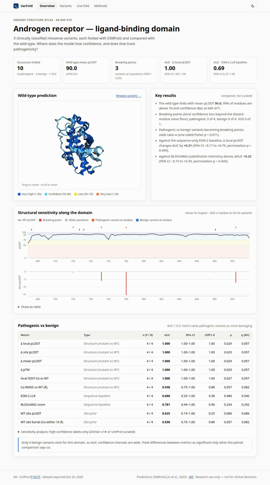
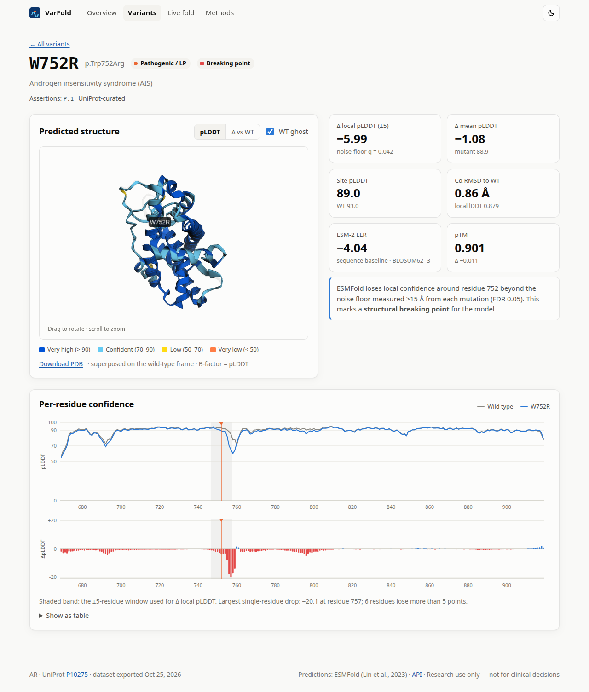

# VarFold

**Predicted 3D structures and structural-confidence analysis of clinical missense variants.**

VarFold folds every clinically classified missense variant in a protein domain with
[ESMFold](https://github.com/facebookresearch/esm), measures where the model loses
confidence relative to the wild type, and tests whether those "structural breaking
points" track pathogenicity. It has two halves:

| Tier | Where | What it does |
|---|---|---|
| **Research engine** (`engine/`, Python package `varfold`) | Local GPU workstation | Curates the dataset, batch-folds hundreds of sequences overnight, computes metrics/statistics/figures for the paper, exports a web bundle, and serves live folds over Tailscale |
| **Showcase app** (`web/`) | Hetzner server (Docker + Caddy) | Public site and JSON API over the precomputed dataset, with a 3Dmol.js viewer; forwards occasional live-fold requests to the workstation |

```
 ┌──────────────── research PC (GPU) ────────────────┐          ┌──────────── Hetzner ────────────┐
 │ varfold curate ─► fold ─► llr ─► validate ─►      │  rsync   │  Caddy (HTTPS, CSP)             │
 │ analyze ─► export ──► varfold.sqlite ─────────────┼─────────►│   └─► FastAPI + React (3Dmol)   │
 │                                                    │          │        ├─ /api/* (read-only)   │
 │ varfold serve  (ESMFold on GPU, bearer token) ◄────┼─ Tailscale ────────┘ /api/live/fold       │
 └────────────────────────────────────────────────────┘          └─────────────────────────────────┘
```



## Run it on your computer

You need Python 3.10+ (3.12 recommended), Node 20+, `git` and `make`.

```bash
git clone https://github.com/gokalpalkoc-lang/varfold.git
cd varfold
```

**1. Just look at it (2 minutes, no GPU, no model download).** Uses the bundled demo
dataset: the wild type plus 9 clinical variants, folded with ESMFold.

```bash
make setup-web
make demo                  # open http://127.0.0.1:8000
```

**2. Live folding on your own machine.** Installs PyTorch and downloads the ESMFold
weights (~8 GB, once). Then type or mutate any sequence on the *Live fold* page and
your computer folds it. An NVIDIA GPU makes this take seconds; on a CPU expect a few
minutes for ~250 residues, and you'll need about 20 GB of free RAM.

```bash
make setup
make live                  # open http://127.0.0.1:8000 → Live fold
```

**3. Reproduce the research dataset.** Curates the variants, folds all of them,
computes the statistics and figures, and serves your own results.

```bash
.venv/bin/varfold all      # resumable; ~406 structures (hours on a GPU, ~1 day on a CPU)
make live                  # the site now shows your data instead of the demo
```

Tip for CPUs with performance and efficiency cores (e.g. Intel Core Ultra):
`export VARFOLD_THREADS=<number of performance cores>` is about 2× faster than the default.



Default target: **androgen receptor ligand-binding domain** (AR, UniProt P10275,
residues 669–919). It has by far the most labelled missense variants of the
hormone receptors checked (androgen insensitivity syndrome), crystal structures to
validate against, and fits ESMFold on an 8 GB GPU. The curated dataset is
**405 variants (305 pathogenic/likely pathogenic, 21 benign/likely benign, 79 VUS)
plus the wild type**. Any other target is one YAML file away (see below).

---

## 1. Setup

### NVIDIA driver (for GPU inference)

Without CUDA everything runs on the CPU, correctly but slowly (~4 min per 251-residue
structure on a Core Ultra 9 185H). The pinned PyTorch build (CUDA 13.0) needs NVIDIA
driver **≥ 580**; Blackwell cards (RTX 50xx) need the *open* kernel modules. On Ubuntu:

```bash
nvidia-smi                          # already working? skip this section
sudo ubuntu-drivers install         # or: sudo apt install nvidia-driver-580-open
sudo reboot                         # with Secure Boot on, enrol the MOK key when prompted
.venv/bin/python -c "import torch; print(torch.cuda.is_available(), torch.cuda.get_device_name())"
```

ESMFold's language model runs in fp16 on the GPU (config `folding.precision`), which fits
~250-residue constructs in 8 GB of VRAM.

### Python + Node

```bash
make setup     # Python 3.12 venv with engine (ml, serve, dev) + backend deps, and npm ci
make test      # engine + API tests and the frontend type-check (no model needed)
cd engine && ../.venv/bin/python -m pytest -m model   # integration tests with the real weights
```

Model weights (~11 GB: ESMFold 8.4 GB, ESM-2 650M 2.5 GB) are downloaded to the
Hugging Face cache on first use. After that, `export HF_HUB_OFFLINE=1` makes runs
fully offline.

---

## 2. Research workflow

Every step is resumable and writes into `data/<target>/`.

```bash
source .venv/bin/activate
varfold curate      # UniProt + EBI Proteins API → dataset.csv (raw API snapshots kept with SHA-256)
varfold fold        # batch ESMFold; Ctrl-C/kill any time, re-run to resume
varfold status      # progress + time-remaining estimate
varfold llr         # ESM-2 masked-marginal baseline scores
varfold validate    # WT prediction vs PDB 2AM9 (SIFTS residue mapping)
varfold analyze     # metrics, statistics, figures, report.md
varfold export      # web bundle: data/ar_lbd/web/varfold.sqlite
```

`varfold all` runs the whole chain. For the overnight batch, run it detached and stop
the live worker first (they share one GPU):

```bash
systemctl --user stop varfold-worker 2>/dev/null
systemd-run --user --unit varfold-batch --working-directory="$PWD" .venv/bin/varfold all
journalctl --user -fu varfold-batch          # or: tail -f data/ar_lbd/varfold.log
```

**Runtime.**

- **Measured on CPU** (Core Ultra 9 185H, fp32, 4 recycles): **~4 min** per
  251-residue structure, so about 27 h for the 406-structure clinical set. That's fine
  for testing; production runs need the GPU.
- **CPU threads:** this hybrid CPU is fastest with `VARFOLD_THREADS=6` (one per P-core).
  Using all 22 logical CPUs is about 2× slower than PyTorch's default.
- **GPU (estimate, not yet measured):** single-digit to tens of seconds per structure on
  the RTX 5070 Laptop. That makes the clinical set a sub-hour to few-hour job, and the
  `saturation` scan (~4,800 structures) a genuine overnight run. Check with
  `varfold status` after the first few structures.

**Reproducibility guarantees**

- Each prediction records a settings fingerprint (`model | recycles | precision`, where
  precision is `fp32` on CPU and `fp16-lm/tf32` or `fp32/tf32` on CUDA). Structures are
  stored per fingerprint (`structures/<fingerprint-hash>/`), so runs never overwrite or
  get paired with each other.
  Analysis compares a variant only with a wild type folded under the *same*
  fingerprint and reports anything else as excluded. CPU (fp32) test runs and GPU
  (fp16 language model) production runs are therefore never mixed. After switching to
  the GPU, `varfold fold` refolds everything automatically.
- Raw API responses are frozen in `raw/` and hashed in `dataset.meta.json`; re-curate
  from them, or pass `--refresh` to take a new snapshot.
- Weights are loaded from the model repository's main branch, in the format it
  publishes. transformers' automatic download of an unreviewed safetensors
  conversion PR is disabled.

### Outputs for the paper

| File | Contents |
|---|---|
| `dataset.csv`, `dataset.meta.json` | The curated variant set, labels, ClinVar/dbSNP ids, provenance |
| `structures/<fp>/*.pdb`, `pae/<fp>/*.npz` | Every predicted structure (B-factor = pLDDT) and its PAE matrix, per settings fingerprint |
| `predictions.jsonl` | Per-residue pLDDT, pTM, runtime, device, versions per structure |
| `analysis/metrics.csv` | Per-variant ΔpLDDT (local/site/global), Cα RMSD, lDDT-Cα, LLR, breaking-point q-values |
| `analysis/positions.csv` | Per-residue aggregates along the domain |
| `analysis/stats.json`, `analysis/report.md` | All tests in machine-readable form + a narrative summary with tables |
| `analysis/figures/fig1–6.{pdf,png}` | WT pLDDT profile, ΔpLDDT by class, ROC, breaking-point map, structure-vs-sequence, saturation heatmap |
| `validation.json` | WT prediction vs crystal structure (RMSD, lDDT, pLDDT calibration) |

### Methodology in brief

- **Primary metric:** Δ local pLDDT, the mean change in Cα pLDDT within ±5 residues of
  the mutation.
- **Breaking points:** ESMFold is deterministic, so there are no replicate runs to
  estimate noise from. Instead, the same windowed statistic is computed at residues
  windows lying entirely more than 15 Å from each mutation, where a substitution should
  have no direct effect.
  That gives an empirical null; variants beyond it at BH-FDR < 0.05 are breaking points.
- **Discrimination:** pathogenic vs benign AUC with stratified bootstrap 95% CIs,
  Mann–Whitney U, Cliff's δ, and BH q-values across metrics. A sensitivity analysis
  repeats it on high-confidence labels only.
- **Baselines a structural metric must beat:** the ESM-2 log-likelihood ratio
  (sequence-only zero-shot predictor), BLOSUM62 (substitution chemistry alone; this
  matters because the benign set is dominated by conservative swaps such as I→V and
  D→E), and site priors (WT pLDDT and burial at the site, which ignore which residue
  is substituted). "Does structure add anything?" is answered by the paired ΔAUC on the
  same variants: a DeLong 95% CI, with the p-value from a paired permutation test.
  DeLong's own p is liberal with only 21 benign variants (7–8% type-I error at nominal
  5% in simulation; the permutation test stays near 5%).
- **Enrichment:** whether pathogenic variants become breaking points more often than
  benign ones is a variant-level one-sided Fisher test. A residue-level version would be
  confounded by how many variants each residue carries.
- **Expect a sober result.** ESMFold was not trained to predict mutation effects, and
  single substitutions often leave predictions nearly unchanged. "pLDDT tracks
  pathogenicity only at buried core positions" or "structure adds little over ESM-2"
  are legitimate findings. The pipeline is built to measure that honestly, not to
  manufacture a signal. With 21 benign variants, CIs are wide; say so in the paper.
- **Numbering:** everything is UniProt canonical numbering. AR literature often uses an
  older numbering (e.g. "T877A" = T878A here).

### Changing the target

Copy `configs/ar_lbd.yaml` and set `uniprot`, `construct.start/end` (keep it under
~400 aa for 8 GB VRAM) and optionally `reference_structure.pdb_id`. Then:

```bash
varfold --config configs/my_target.yaml curate
```

Set `variants.scan: alanine | saturation` to add systematic in-silico mutagenesis.

---

## 3. Showcase web app

### Local development

```bash
make dev-api     # FastAPI on :8000 serving data/ar_lbd/web/varfold.sqlite
make dev-web     # Vite on :5173 with /api proxied to :8000
```

Pages: **Overview** (headline numbers, WT structure, breaking-point map,
discrimination table), **Variants** (filter/sort/search, URL-shareable state),
**Variant detail** (3D mutant vs WT ghost, pLDDT or ΔpLDDT colouring, synchronized
per-residue charts, ClinVar links, PDB download), **Live fold**, and **Methods**
(generated from the dataset's own provenance). The JSON API is documented at
`/api/docs`.

### Deploying to Hetzner

On the server (Docker + Compose installed, DNS A/AAAA record pointing at it):

```bash
git clone <this repo> /opt/varfold && cd /opt/varfold/deploy
cp .env.example .env && nano .env          # DOMAIN, worker URL + token
mkdir -p data
docker compose up -d --build                # Caddy obtains the TLS certificate
```

From the research PC, publish (and later re-publish) the dataset:

```bash
VARFOLD_SERVER=deploy@your-server ./deploy/publish.sh
```

The site runs entirely from the bundle. Live folding is optional: leave
`VARFOLD_WORKER_URL` empty and the Live page reports it as disabled. Exact dataset
sequences are always answered instantly from the bundle, without touching the GPU.

### Live folding over Tailscale

1. Install Tailscale on both machines (`curl -fsSL https://tailscale.com/install.sh | sh && sudo tailscale up`).
2. Restrict the tailnet so only the server can reach the worker port. Tag the
   machines in the admin console and add an ACL such as:
   ```json
   {
     "tagOwners": { "tag:web": ["autogroup:admin"], "tag:gpu": ["autogroup:admin"] },
     "acls": [ { "action": "accept", "src": ["tag:web"], "dst": ["tag:gpu:8100"] } ]
   }
   ```
3. On the research PC, install the worker as a user service (instructions in
   `deploy/varfold-worker.service`). It binds **only** to the Tailscale IP and requires
   the bearer token from `~/.config/varfold/worker.env`.
4. Put the PC's Tailscale IP and the same token into the server's `.env`
   (`VARFOLD_WORKER_URL=http://100.x.y.z:8100`).

Defence in depth: the tailnet ACL, Tailscale-only binding, constant-time token check,
one GPU job at a time with a bounded queue (503 + `Retry-After` when full), server-side
sequence validation and length cap, per-IP hourly limit (429), a request timeout, and a
strict CSP at Caddy.

---

## Repository layout

```
configs/            target definitions (YAML)
engine/varfold/     research engine: curate, folding, llr, validate, metrics, stats, figures, analyze, export, worker, cli
engine/tests/       unit + end-to-end tests (synthetic run with planted signal; no model needed)
web/backend/app/    FastAPI: read-only dataset API, live-fold proxy, SPA hosting
web/backend/tests/  API tests against a bundle built by the real exporter
web/frontend/       React + TypeScript + Vite; 3Dmol.js viewer, SVG charts
deploy/             docker-compose, Caddyfile, worker systemd unit, publish script
data/<target>/      generated (git-ignored)
```

## Credits

ESMFold & ESM-2 (Meta AI, MIT licence) · UniProt · EBI Proteins API · ClinVar ·
PDBe SIFTS · RCSB PDB · 3Dmol.js (BSD). Research use only. Nothing here is a
clinical interpretation.
